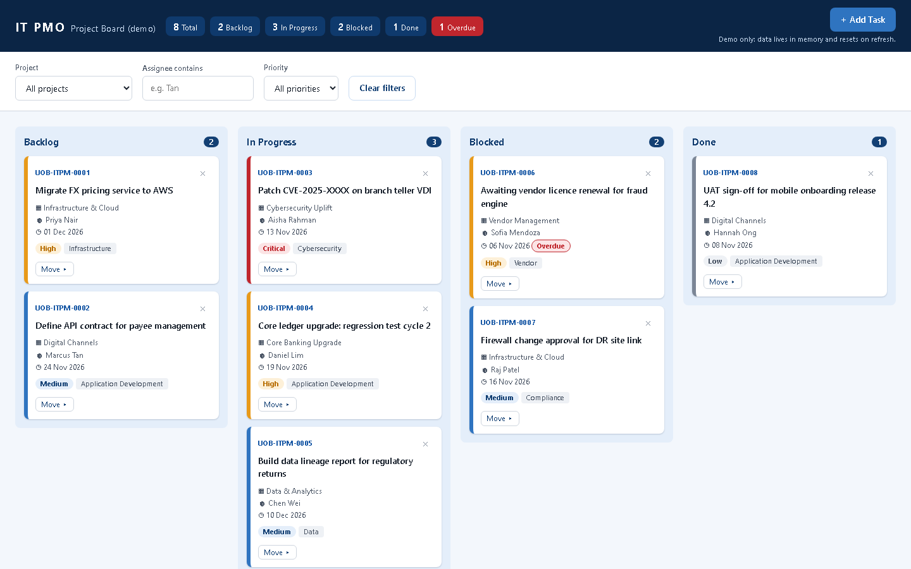
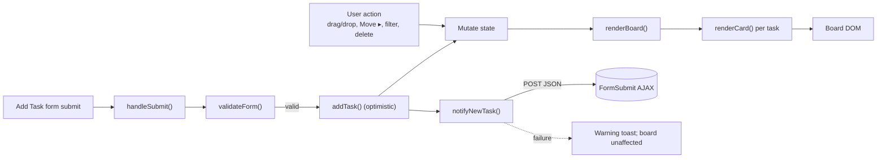

# ClaudeCode_Training: IT PMO Kanban Board

A single-file demo Kanban board for a fictitious bank's IT PMO, built with vanilla HTML, CSS and JavaScript. It uses no real bank branding.


[](https://github.com/giandagdag/ClaudeCode_Training/actions/workflows/ci.yml)
[](https://giandagdag.github.io/ClaudeCode_Training/)

## Live demo

**<https://giandagdag.github.io/ClaudeCode_Training/>** (original)

**<https://giandagdag.github.io/ClaudeCode_Training/v2/>** (v2: Apple-style redesign, same features, in `v2/index.html`)



## Features

- **Four columns:** Backlog, In Progress, Blocked and Done, with a summary strip in the header that counts every task.
- **Moving tasks:** drag and drop cards with a mouse, or use the keyboard-accessible **Move ▸** menu on each card.
- **Filters:** filter by project, by assignee (text contains) and by priority. Filters affect the board columns only.
- **Overdue badges:** a task is marked overdue when its due date is before today and it isn't Done. Seed due dates are set relative to today, so the badges always appear in the demo.
- **Add Task modal:** a form with validation for title, description, project, category, assignee, priority, due date and status. When you save, the new task appears on the board straight away and an email notification is sent through [FormSubmit](https://formsubmit.co) (if configured).
- **No persistence:** state lives in memory only and resets to the seed data when you refresh. The UI tells you this.

## Architecture

State flows one way: a user action mutates `state`, and then `renderBoard()` rebuilds the board.



- **`state = { tasks, filters, ui }`** is the single source of truth. `ui` holds transient flags (`moveOpenId`, `deleteConfirmId`, `focusSel`), so open menus, the inline "Delete? Yes/No" prompt and keyboard focus survive each full re-render.
- **Event delegation:** a few listeners on `#board`, set up in `initBoardEvents()`, handle every button `data-action` click and the native drag/drop events. These listeners survive re-renders. Drag/drop and the Move menu both end in `moveTask()`.
- **Escaping:** card HTML is built as strings by `renderCard()`, and every user-supplied value goes through `escapeHtml()`. Toasts use `textContent`.
- **Task IDs** use the format `UOB-ITPM-####` and come from an incrementing counter. The seed tasks take 0001–0008.
- **Overdue logic:** `dueDate < today && status !== "Done"`, comparing local `YYYY-MM-DD` strings.

### Project structure

```
.
├── index.html                # The whole app: markup, <style>, <script>
├── README.md
├── CLAUDE.md                 # Guidance for Claude Code / contributors
├── .gitignore
├── docs/
│   └── screenshot.png        # README screenshot (not deployed)
└── .github/
    └── workflows/
        └── ci.yml            # Checks, secret scan, Pages deploy
```

## How to install / run

```bash
git clone https://github.com/giandagdag/ClaudeCode_Training.git
cd ClaudeCode_Training
```

Then open `index.html` in a browser (double-click it, or use a `file://` URL). You don't need a server, npm or a build step.

### Optional: email notifications

1. Create a [FormSubmit](https://formsubmit.co) alias for your inbox. FormSubmit emails you a random-string alias after the first activation.
2. In `index.html`, replace the placeholder in `FORMSUBMIT_ENDPOINT`:
   ```js
   const FORMSUBMIT_ENDPOINT = "https://formsubmit.co/ajax/<your-alias>";
   ```

> [!WARNING]
> Never commit your personal email address into `FORMSUBMIT_ENDPOINT`. This repo and its Pages site are public. Use the FormSubmit alias. CI fails if the endpoint contains an email address.

While the placeholder `YOUR_EMAIL@example.com` is still in place, `notifyNewTask` skips the network call and shows a warning toast.

## CI/CD

[`.github/workflows/ci.yml`](.github/workflows/ci.yml) runs on every push, every pull request, and on manual dispatch:

| Job | What it does |
|---|---|
| `checks` | Fails if `index.html` is missing or empty, if it uses browser storage APIs, `!important`, or external `<script src>`/`<link href>`, if it references any host other than `formsubmit.co` or `www.w3.org`, or if `FORMSUBMIT_ENDPOINT` contains a real email address. |
| `secret-scan` | Runs [gitleaks](https://github.com/gitleaks/gitleaks-action) over the full git history. |
| `deploy` | Runs only on `main`, and only after both jobs above pass. It stages **only** `index.html` (at `/`) and `v2/index.html` (at `/v2/`) into `_site/` and deploys them to GitHub Pages. |

## Security and privacy

- The only network call is the optional FormSubmit notification. Nothing else is fetched or sent.
- The app uses no `localStorage`, `sessionStorage`, IndexedDB or cookies.
- All user input is escaped before it is rendered.
- Only `index.html` and `v2/index.html` are published to Pages.
